# Git workflow: exact steps

Every command below was run, in this order, to build this repository and to
create and resolve the merge conflict. Screenshots are in
[`docs/screenshots/`](../screenshots/).

Repository: https://github.com/VidhuSarwal/tldr-go

## 1. Create the repository and the first commits

```bash
git init -b main                      # new repository, default branch "main"
git config user.name  "Vidhu"         # identity for this repository only
git config user.email "<GitHub noreply address>"

git add README.md .gitignore go.mod
git commit -m "Initial commit: README, .gitignore and Go module"
git add docs/sdlc
git commit -m "Add requirements and Incremental SDLC design"
git add summarize/summarize.go
git commit -m "Add sentence splitting and frequency-based scoring"
git add main.go testdata
git commit -m "Add tldr command-line interface and sample text"
git add summarize/summarize_test.go
git commit -m "Add unit tests T1-T5 for increment 1"
```

## 2. Connect GitHub and push

```bash
gh repo create VidhuSarwal/tldr-go --public
git remote add origin git@github.com:VidhuSarwal/tldr-go.git
git push -u origin main
```

## 3. Pull a change made somewhere else

A second clone stood in for another machine. It added a GitHub Actions
workflow that runs `go vet` and `go test` on every push, and pushed it:

```bash
# in the second clone
git clone git@github.com:VidhuSarwal/tldr-go.git
git add .github/workflows/test.yml
git commit -m "Add GitHub Actions workflow to vet and test on every push"
git push origin main
```

Back in the original copy, `git fetch` showed the branch was behind, and
`git pull` brought the commit in:

```text
$ git status -sb
## main...origin/main [behind 1]
$ git pull
Updating 61f25a0..a645d5b
Fast-forward
 .github/workflows/test.yml | 18 ++++++++++++++++++
```

The pull is also recorded in the reflog (`HEAD@{9}: pull: Fast-forward`,
screenshot 13).

## 4. Two feature branches from the same commit

Both branches start at `a645d5b`, and both change the `score()` function in
`summarize/summarize.go`.

```bash
git switch -c feature/position-weighting
# edit score(): new count parameter; the return line multiplies by positionWeight()
# add summarize/position.go and summarize/position_test.go
go test ./...
git add -A
git commit -m "Boost sentences near the start of the text (increment 2)"

git switch main
git switch -c feature/stopwords
# edit score(): skip stopwords, count the words used; the return line divides by counted
# add summarize/stopwords.go and summarize/stopwords_test.go
go test ./...
git add -A
git commit -m "Ignore stopwords when scoring sentences (increment 3)"

git push -u origin feature/position-weighting feature/stopwords
```

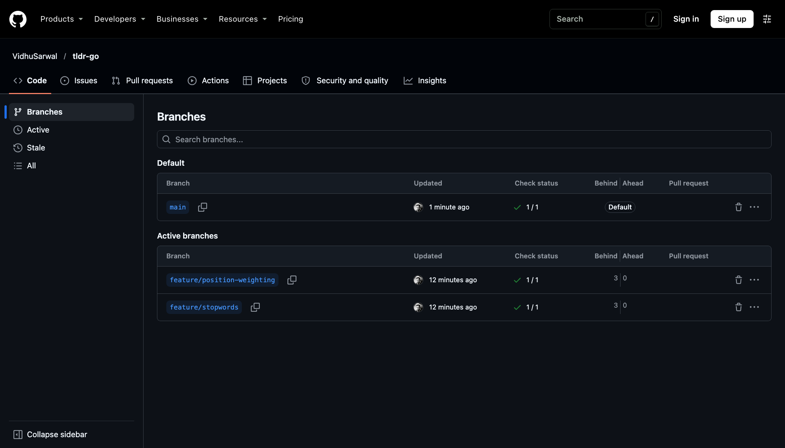

## 5. Merge the first branch

```bash
git switch main
git merge --no-ff feature/position-weighting -m "Merge branch 'feature/position-weighting'"
git push origin main
git log --oneline --graph --all
```

Git merged it automatically ("Merge made by the 'ort' strategy").

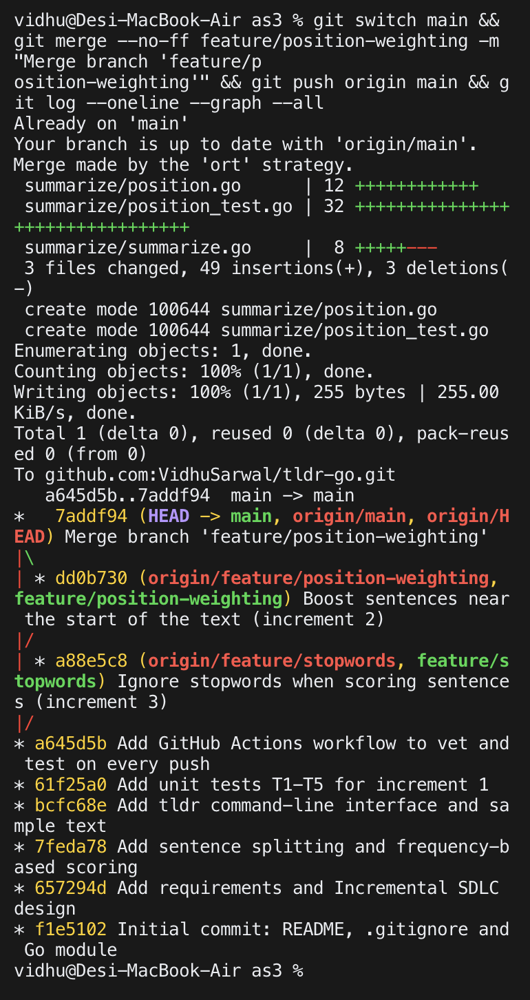

## 6. Merge the second branch: the conflict

```text
$ git merge feature/stopwords
Auto-merging summarize/summarize.go
CONFLICT (content): Merge conflict in summarize/summarize.go
Automatic merge failed; fix conflicts and then commit the result.
```

`git status` listed `summarize/summarize.go` as **both modified**.
`git diff` showed that Git had already merged the stopword loop by itself.
It stopped only on the `return` line, which both branches had rewritten:

```text
<<<<<<< HEAD
	// Opening sentences usually state the main idea, so they get a boost.
	return total / float64(len(s.Words)) * positionWeight(s.Index, count)
=======
	if counted == 0 {
		return 0
	}
	return total / float64(counted)
>>>>>>> feature/stopwords
```

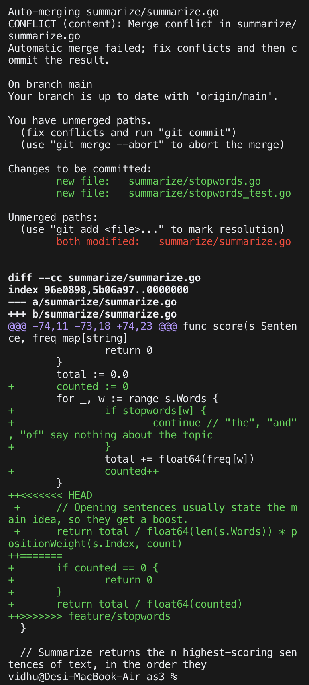

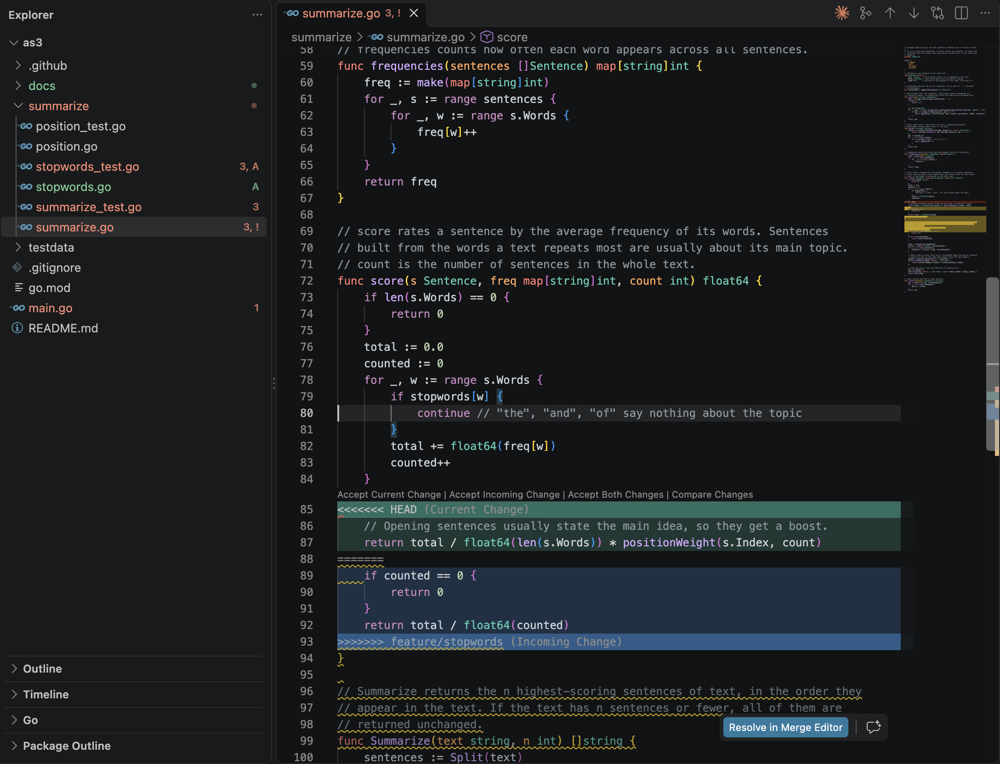

## 7. Resolve it by hand

Choosing either side would have thrown away one increment. Instead I
replaced the whole block, markers included, with a line that keeps both
changes:

```go
	if counted == 0 {
		return 0
	}
	// Opening sentences usually state the main idea, so they get a boost.
	return total / float64(counted) * positionWeight(s.Index, count)
```

In `git diff`, the `++` line is new compared with **both** parents, so it is
the hand-written resolution. Running the tests then exposed a second
problem:

```text
$ go test ./...
summarize/stopwords_test.go:9:21: not enough arguments in call to score
	have (Sentence, map[string]int)
	want (Sentence, map[string]int, int)
FAIL	github.com/VidhuSarwal/tldr-go/summarize [build failed]
```

The stopwords branch's tests were written against the old two-argument
`score()`. Git saw no textual conflict there because the two branches
touched different files, but together the code no longer compiled. I
updated both calls to pass a sentence count of 1 and ran the tests again.

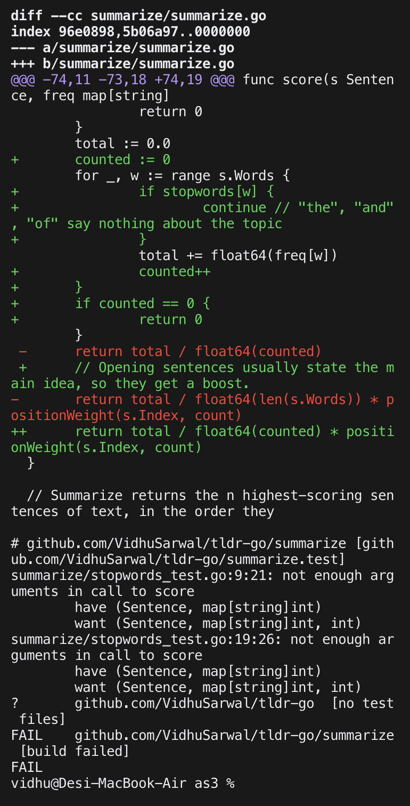

## 8. Finish the merge

```bash
go test -v ./summarize/            # all 9 tests (14 with subtests) pass
git add summarize/summarize.go summarize/stopwords_test.go
git status                         # "All conflicts fixed but you are still merging."
git commit --no-edit               # 7750acc Merge branch 'feature/stopwords'
git push origin main
git log --oneline --graph -12
```

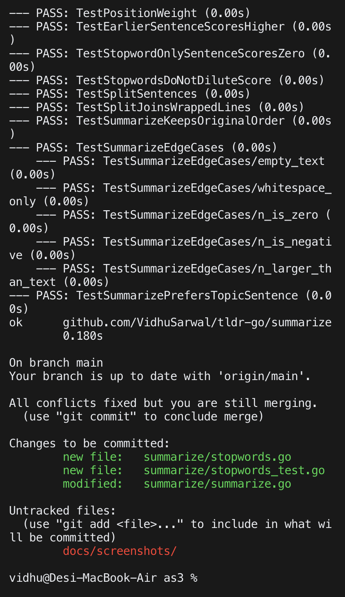

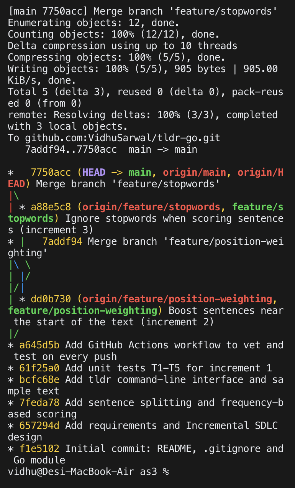

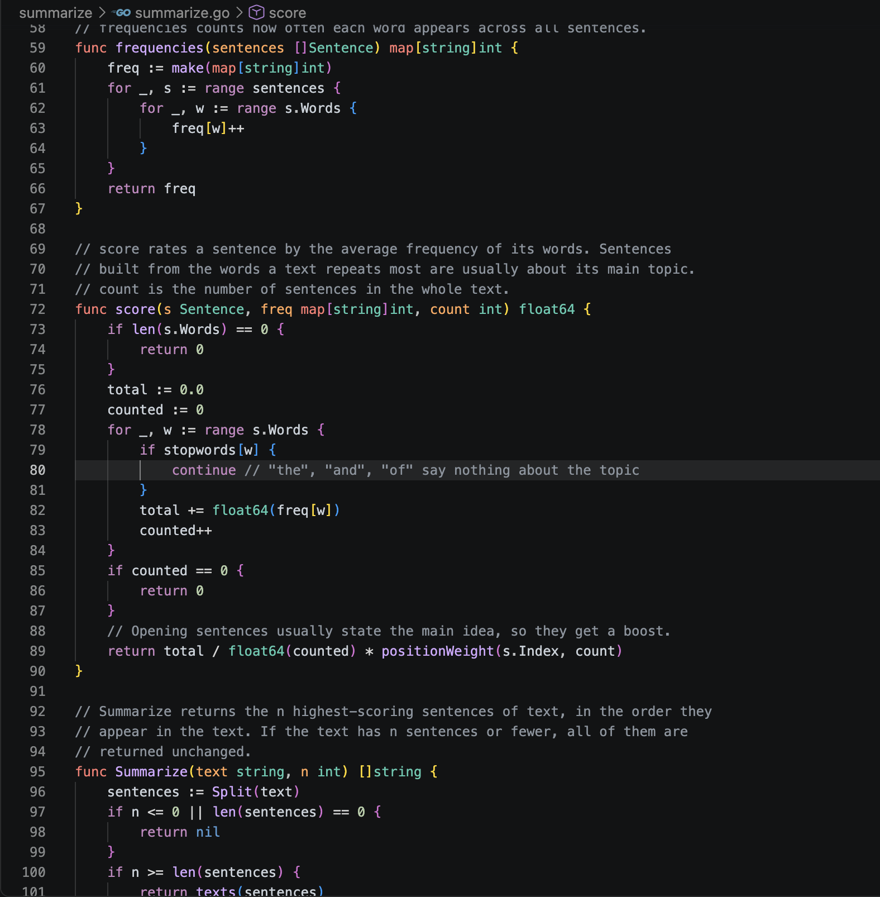

## 9. Check the result on GitHub

- The merge commit `7750acc` has two parents (`7addf94` and `a88e5c8`), and
  Git recorded `Conflicts: summarize/summarize.go` in its message.
- GitHub Actions passed on every push, including both merges.

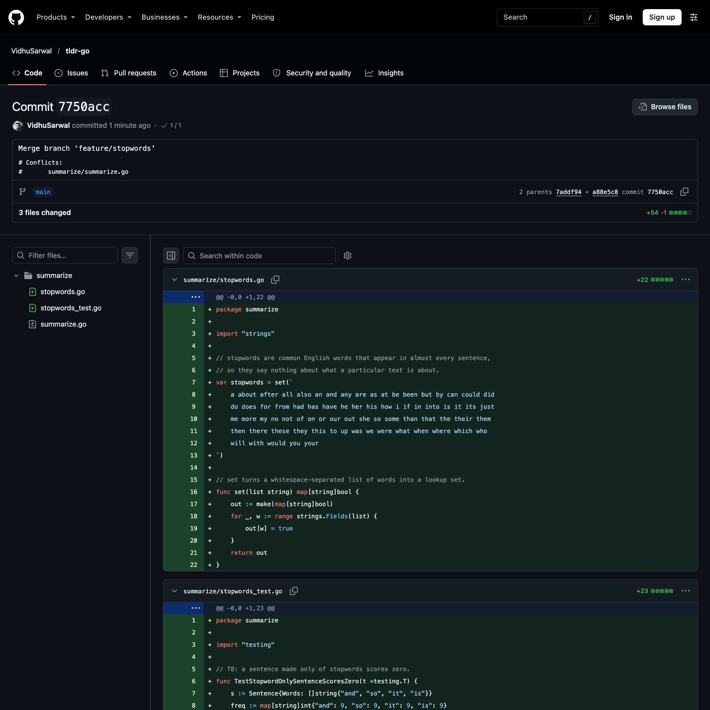

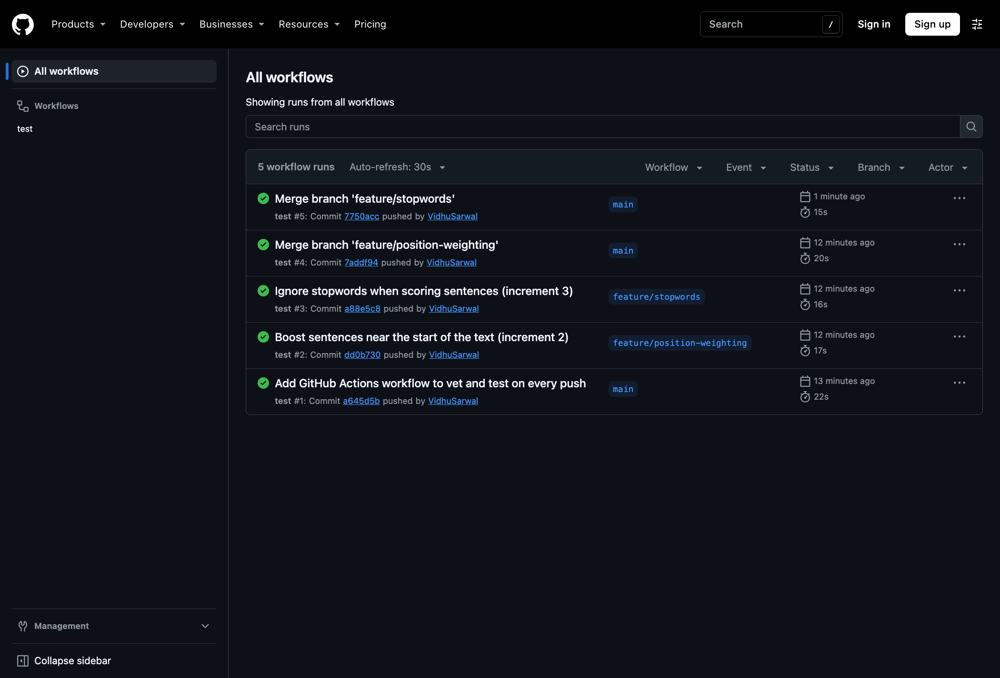

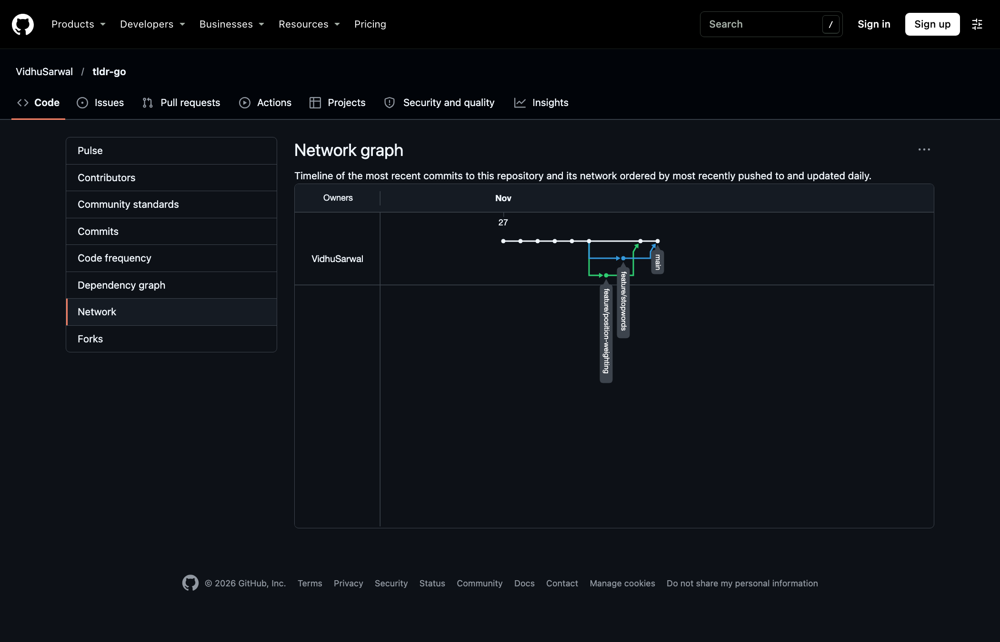

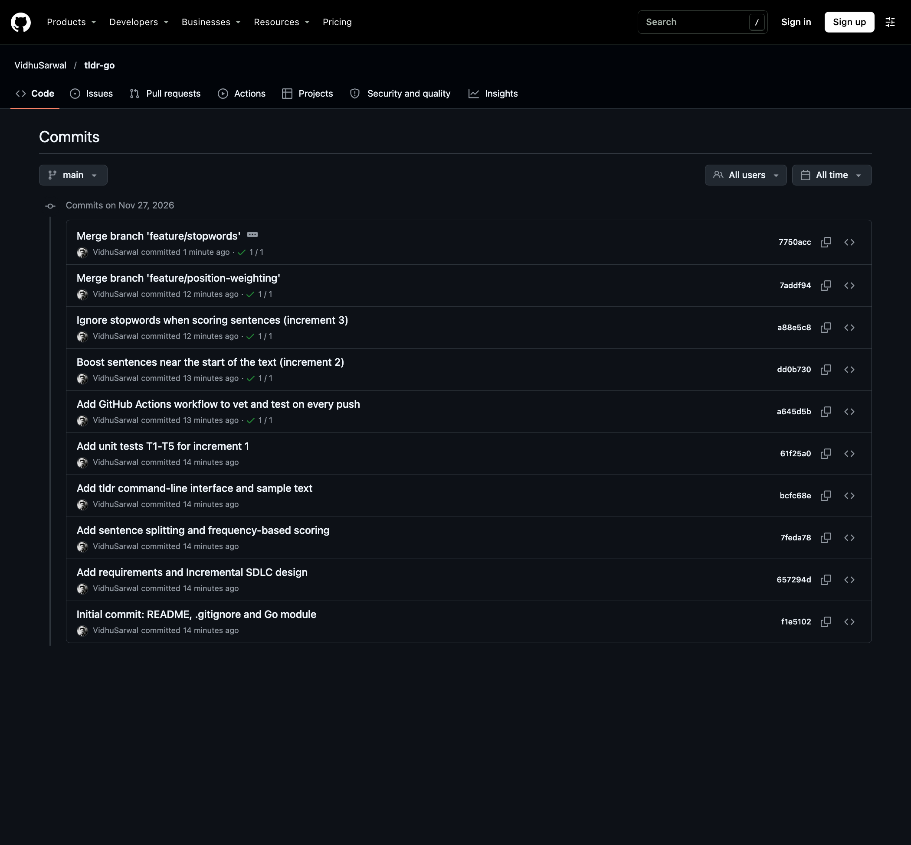

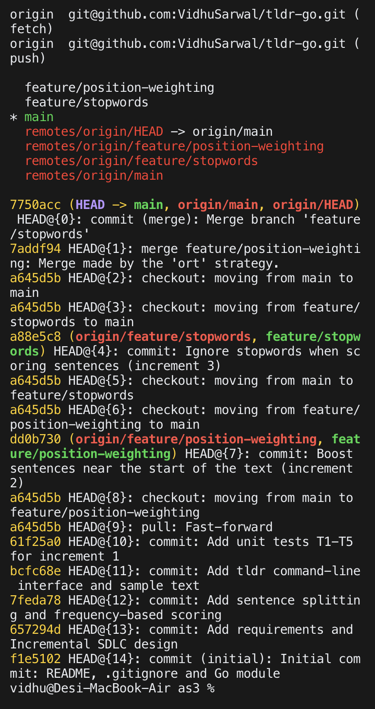

## Commands I could have used instead

- `git merge --abort` returns to the state before the merge, if a
  resolution goes wrong.
- `git restore --merge summarize/summarize.go` puts the conflict markers
  back in a file after a bad edit, without undoing the whole merge.
- `git rebase main` on `feature/stopwords`, instead of merging, would have
  raised the same conflict but kept the history linear.
