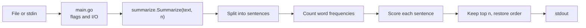

# tldr: SDLC Model, Plan, Design and Test Plan

Requirements are in [requirements.md](requirements.md).

## 1. Chosen model: Incremental

The system is built as a series of small increments. Each increment runs its
own short cycle (design, code, test, integrate) and leaves `main` holding a
working, usable tool.

### Why Incremental suits this project

| Factor | This project | Why Incremental fits |
| --- | --- | --- |
| **Scope** | Small and well understood. The core (split, score, print) is clear from the start; the scoring refinements are optional extras. | The core ships first. Refinements are added as separate increments without redesigning what already works. |
| **Risk** | Low technical risk. The real risks are that a scoring rule makes summaries worse, or that two changes to the scoring code clash. | Each increment is tested on its own and integrated separately, so a bad rule is caught and reverted alone, and integration problems appear one increment at a time. |
| **Time** | About one week, part-time, with a hard deadline. | A working tool exists after increment 1, so there is always something to submit whatever happens to later increments. |

### Why not the other models

- **Waterfall:** the requirements are stable enough, but Waterfall delivers
  nothing usable until the end and leaves all integration and testing to one
  late phase. With a fixed deadline, that is the riskiest place to put them.
- **Spiral:** built around repeated formal risk analysis and prototyping. That
  overhead does not pay off for a one-person, low-risk tool.
- **RAD:** relies on user workshops and fast prototyping of a user interface.
  tldr has no graphical interface and no customer group to run workshops with.

## 2. Plan

| Increment | Delivers | Requirements | Git branch | Estimate |
| --- | --- | --- | --- | --- |
| 1. Core | Sentence splitting, word-frequency scoring, top *N* in original order, CLI (file or stdin, `-n`) | FR1–FR5, FR8 | `main` | 2 days |
| 2. Position weighting | Sentences near the start of the text score higher | FR6 | `feature/position-weighting` | 1 day |
| 3. Stopword filtering | Filler words are ignored when scoring | FR7 | `feature/stopwords` | 1 day |
| 4. Future | Keyword highlighting, JSON output | — | — | — |

Increments 2 and 3 are built in parallel on separate branches and integrated
into `main` one at a time. Both change the same scoring function, so
integrating the second one is expected to need a manual merge. This is
planned for in the schedule rather than discovered late.

**Milestones**

- **M1** (day 2): increment 1 on `main`; tests pass on CI.
- **M2** (day 4): increments 2 and 3 integrated; all tests pass together.
- **M3** (day 5): report written.

## 3. Design

### Architecture



### Units

| Unit | Responsibility |
| --- | --- |
| `main.go` | Parse `-n`, read the file or stdin, print the summary, report errors on stderr |
| `summarize.Split` | Normalise whitespace, cut sentences, turn each into lower-case words |
| `summarize.frequencies` | Count each word across the whole text |
| `summarize.score` | Rate one sentence. This is the extension point that increments 2 and 3 change. |
| `summarize.positionWeight` | (Increment 2) Weight from 1.5× for the first sentence down to 1.0× for the last |
| `summarize.stopwords` | (Increment 3) A set of about 80 common English words |

### Data

```go
type Sentence struct {
    Text  string   // the sentence as written
    Words []string // lower-case words, punctuation removed
    Index int      // position in the text, from 0
}
```

### Scoring

- **Increment 1:** score = (sum of the frequencies of the sentence's words) ÷ (number of words).
- **Increment 2:** multiply by `positionWeight(index, count) = 1.5 − 0.5 × index ÷ (count − 1)`.
- **Increment 3:** leave stopwords out of both the sum and the word count.

### Design decisions

- **Extractive, not AI-generated:** deterministic and works offline. It
  selects existing sentences, but summaries still need quality review.
- **Standard library only:** separate executable builds for each platform,
  with nothing else to install.
- **All scoring in one function:** each increment changes one place. This also
  means increments 2 and 3 meet in that function, which is the integration
  risk named above.

## 4. Test plan

**Levels**

- **Unit:** `go test ./...`
- **Acceptance:** run the CLI on `testdata/sample.txt` and check the summary by hand.
- **Regression:** GitHub Actions runs `go vet` and `go test` on every push.

| ID | Increment | Test | Expected result |
| --- | --- | --- | --- |
| T1 | 1 | Split "Go is fast. It compiles quickly! Does it scale? Yes." | 4 sentences |
| T2 | 1 | Split text with line breaks inside a sentence | Line breaks treated as spaces |
| T3 | 1 | Summarize 3 of 5 sentences | Exactly 3, in original order |
| T4 | 1 | Empty text; `n` ≤ 0; `n` larger than the text | Nothing; nothing; every sentence |
| T5 | 1 | Text with a clear topic plus one off-topic sentence | The off-topic sentence is not chosen |
| T6 | 2 | `positionWeight` for the first and last sentence | 1.5 and 1.0 |
| T7 | 2 | The same sentence at the start and at the end | The first copy scores higher |
| T8 | 3 | A sentence made only of stopwords | Scores 0 |
| T9 | 3 | Add "the", "of", "and" to a sentence | Its score does not change |
| T10 | 2 + 3 | After both increments are integrated | T1–T9 all pass together |

**Exit criteria:** every test passes locally and on CI, and the sample summary
has been reviewed by hand.

Testing outcomes and the integration of increments 2 and 3 are recorded in the
report.
