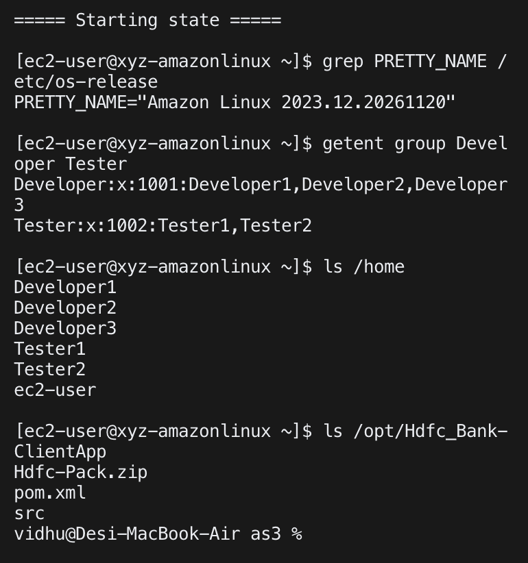
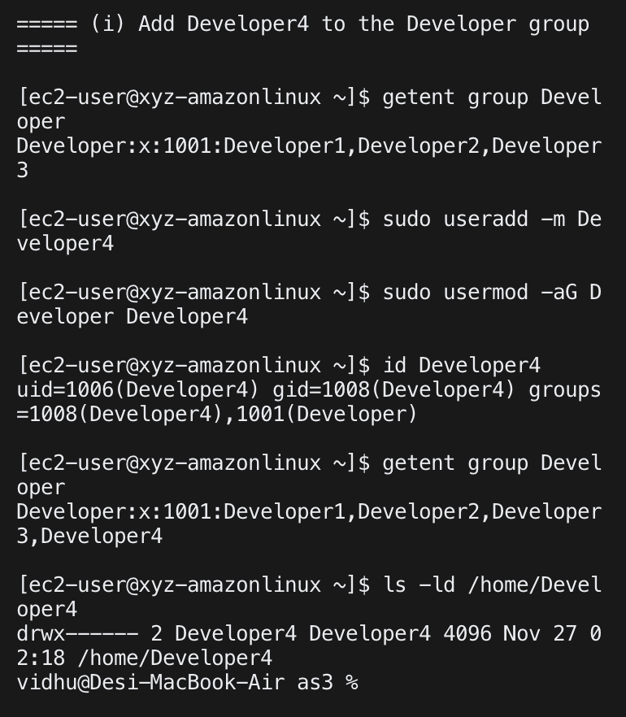
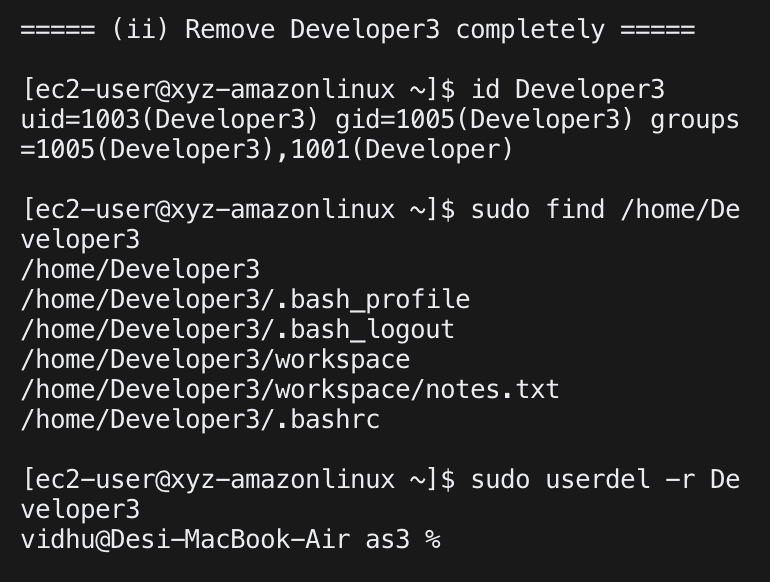
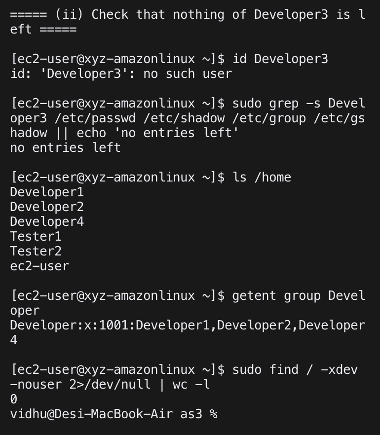
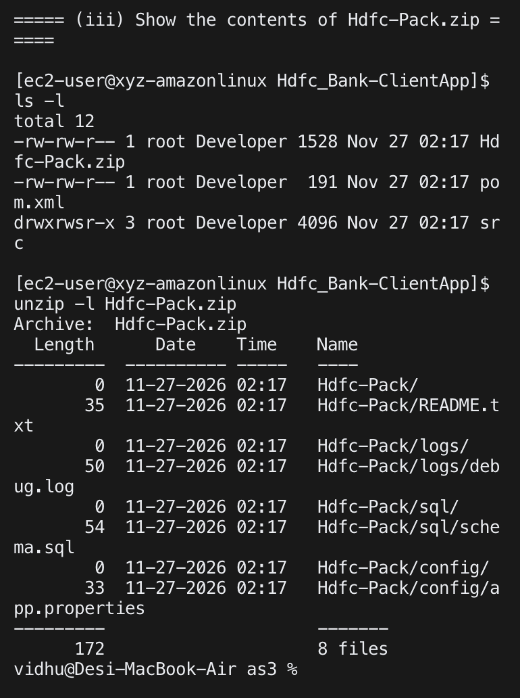
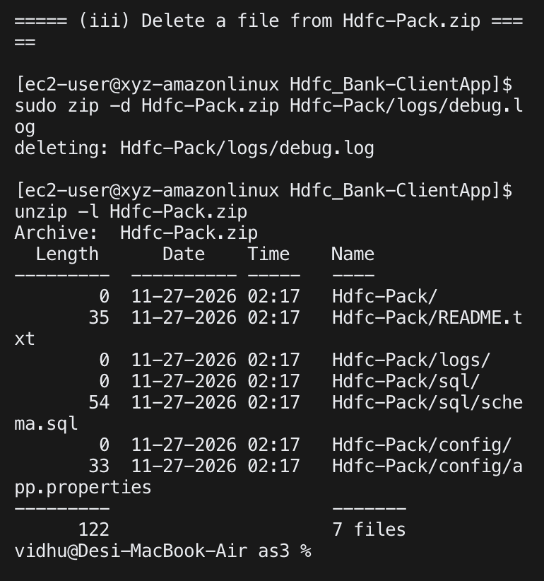

# Linux-based user management on Amazon Linux

## Scenario

XYZ owns an Amazon Linux machine that hosts the web-based Java project
**Hdfc_Bank-ClientApp**.

- **Team A** (Developer1, Developer2, Developer3) belongs to the **Developer** group.
- **Team B** (Tester1, Tester2) belongs to the **Tester** group.

Tasks:

1. A new user, Developer4, joins and must be added to the Developer group.
2. Developer3 leaves: remove the account and its home directory completely.
3. Display the contents of the zip archive `Hdfc-Pack` in the project, then
   delete a file.

## Environment

The commands ran on **Amazon Linux 2023** (`Amazon Linux 2023.12.20261120`),
in a container built from the official `amazonlinux:2023` image
([Dockerfile](Dockerfile)). It is set up like a fresh EC2 instance: you work
as `ec2-user` and run administrative commands with `sudo`. The hostname is
`xyz-amazonlinux`.

On a real EC2 instance the commands are exactly the same.

**Assumptions**

- Linux user names cannot contain spaces, so "Developer 4" is `Developer4`,
  and likewise for the others.
- Each user keeps a private primary group of the same name (the Amazon Linux
  default) and joins the team group as a supplementary group. That is why
  `getent group Developer` lists the members by name.
- "Delete a file" is read as deleting a file from **inside** the zip archive.
  An alternative reading is shown at the end.

## Starting state

[setup.sh](setup.sh) creates the groups, the five users, a little personal
work in Developer3's home, and the project under `/opt/Hdfc_Bank-ClientApp`.
The project is owned by `root:Developer`: developers can write to it and
everyone else can read it. It contains `Hdfc-Pack.zip`.



## (i) Add Developer4 to the Developer group

```bash
sudo useradd -m Developer4               # create the account and /home/Developer4
sudo usermod -aG Developer Developer4    # append Developer to its supplementary groups
id Developer4                            # check: groups include 1001(Developer)
getent group Developer                   # check: Developer4 is listed as a member
```

- `-m` creates the home directory.
- In `usermod`, `-a` (append) matters: `-G` without `-a` would *replace*
  the user's supplementary groups instead of adding one.
- The same result in one command: `sudo useradd -m -G Developer Developer4`.

**Result:** `id` shows `groups=1008(Developer4),1001(Developer)`, and the
group now reads `Developer:x:1001:Developer1,Developer2,Developer3,Developer4`.



## (ii) Remove Developer3 completely

```bash
id Developer3                        # confirm the account exists
sudo find /home/Developer3           # what will be removed
sudo userdel -r Developer3           # delete the account, its home directory and mail spool
```

`userdel -r` removes the entries in `/etc/passwd`, `/etc/shadow`, `/etc/group`
and `/etc/gshadow`, the private `Developer3` group, the membership in
Developer, the home directory, and the mail spool.

Then check that nothing is left:

```bash
id Developer3                                   # "no such user"
sudo grep -s Developer3 /etc/passwd /etc/shadow /etc/group /etc/gshadow || echo 'no entries left'
ls /home                                        # /home/Developer3 is gone
getent group Developer                          # Developer3 no longer a member
sudo find / -xdev -nouser 2>/dev/null | wc -l   # 0 files left without an owner
```

The last check matters because `userdel -r` only deletes the home directory
and mail spool. Files the user owned elsewhere would survive with no owner.
The count of 0 shows there were none.

On a busy server, also run `sudo pkill -u Developer3` first (userdel refuses
to remove a logged-in user), and back up the home directory if the company
needs to keep the work.





## (iii) Display the zip contents, then delete a file

```bash
cd /opt/Hdfc_Bank-ClientApp
ls -l                                                  # the project, owned by root:Developer
unzip -l Hdfc-Pack.zip                                 # list the archive: 8 entries
sudo zip -d Hdfc-Pack.zip Hdfc-Pack/logs/debug.log     # delete one file from the archive
unzip -l Hdfc-Pack.zip                                 # list again: 7 entries
```

- `unzip -l` lists the archive without extracting it.
- `zip -d` deletes an entry from the archive in place.
- `sudo` is needed because `ec2-user` is not in the Developer group that
  owns the project.

The stray `debug.log` was removed. The listing went from 8 entries
(172 bytes) to 7 entries (122 bytes).





**Alternative reading** (extract, then delete a file from the extracted
folder):

```bash
unzip Hdfc-Pack.zip -d /tmp/pack && ls -R /tmp/pack
rm /tmp/pack/Hdfc-Pack/logs/debug.log
```

## Full output

[transcript.txt](transcript.txt) has the complete output of every step,
exactly as printed.

## Run it yourself

```bash
cd linux-user-management
docker build -t xyz-amazonlinux .
docker run -d --name xyz-amazonlinux --hostname xyz-amazonlinux xyz-amazonlinux
docker exec xyz-amazonlinux /opt/scripts/setup.sh
docker exec xyz-amazonlinux /opt/scripts/tasks.sh all
docker rm -f xyz-amazonlinux
```

[tasks.sh](tasks.sh) prints each command after a shell prompt and then runs
it, so its output reads like an interactive session.
